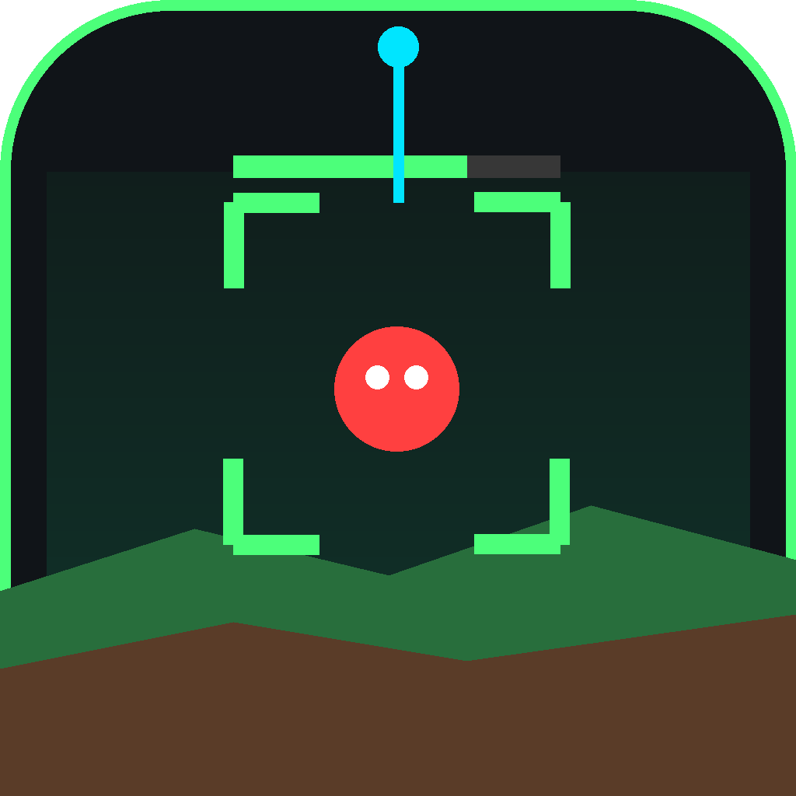

# Terraria ESP (overlay flutuante)

App Android com **botão flutuante pequeno** que abre um mini-menu com:

- Linha ESP
- Box ESP
- Vida (experimental)
- Distância (em blocos aproximados)
- Filtros: Animais, NPC/Mobs, Player

Feito para o **Terraria offline (single player)**.

## Como funciona
O app usa captura de tela (MediaProjection) e detecta **o que se move** comparando frames.
Não lê memória nem modifica o jogo.

## Limitações (importante)
- Só vê o que está na tela.
- Animal / NPC-Mob / Player é separado por **tamanho e posição**, não por identificação real.
- Quando a câmera anda junto com o player, o fundo também muda e a detecção pausa por instantes.
- Vida só aparece se o jogo estiver mostrando a barra de vida do inimigo.
- Para dados 100% precisos (tipo, vida real, fora da tela), o caminho é um mod tModLoader.

## Gerar o APK pelo GitHub
1. Crie um repositório e envie todos estes arquivos.
2. Aba **Actions** > **Build APK** (roda sozinho a cada push).
3. Ao terminar, baixe o artefato **TerrariaESP-apk** (`app-debug.apk`).

## Usar
1. Instale o APK, abra o app e toque **Permitir sobreposição**.
2. Toque **Iniciar ESP** e aceite a captura de tela.
3. Abra o Terraria. Toque no botão flutuante para abrir/fechar o menu; arraste para mover.
